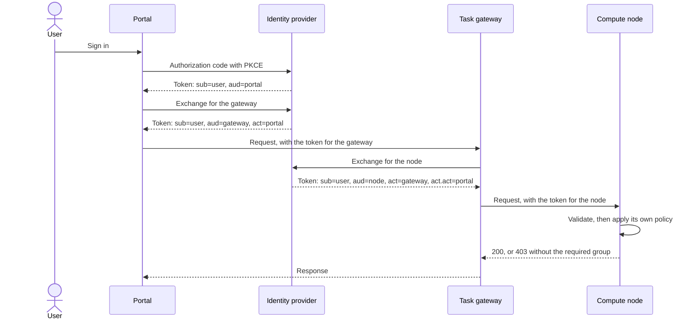

# Design

The end state: all software follows the standards, and nothing is held back by what any product supports today. This page describes that, and nothing else. What we can show of it today, and why, is under Testbed limits.

## Overview

### Trust model

- **An identity provider** vouches for users, and issues all tokens. Every service trusts it, and verifies its signatures by itself ([R-S4](requirements.md#security-requirements)). This page shows one. Across several, [identity and authorization chaining](https://datatracker.ietf.org/doc/draft-ietf-oauth-identity-chaining/) (a draft) builds on the same exchange.
- **Services don't trust each other** for anything about a user. What a service knows about a request is what the token says, and what the identity provider confirms.
- **Each token has one audience,** the next service, and is of no use elsewhere ([R-S1](requirements.md#security-requirements)).
- **Services hold no standing credentials** for users. They act within a request, with a token they've just obtained for the next hop ([R-S2](requirements.md#security-requirements)).
- **Nodes decide for themselves** whom they accept ([R-S5](requirements.md#security-requirements)).

### The flow

A workflow system between the portal and the gateway adds one more exchange, and one more level of `act`. Claims in the diagram are shorthand: `act` is an object with its own `sub`, and `act.act` is nested in it.

## Authentication

A user signs in once at the portal, with [OpenID Connect](https://openid.net/specs/openid-connect-core-1_0.html), using the authorization code flow ([OAuth 2.0, RFC 6749](https://datatracker.ietf.org/doc/html/rfc6749)) with [PKCE (RFC 7636)](https://datatracker.ietf.org/doc/html/rfc7636). [R-U1](requirements.md#user-requirements) follows, as everything after that is an exchange without the user.

Access tokens are JWTs in the profile of [RFC 9068](https://datatracker.ietf.org/doc/html/rfc9068), so that a service can validate them offline: the signature, `iss`, `aud`, `exp`, `nbf` if present, and the type `at+jwt` or `application/at+jwt`. That's all a service must do, which is [R-S9](requirements.md#security-requirements). Devices without a browser can use the [device authorization grant (RFC 8628)](https://datatracker.ietf.org/doc/html/rfc8628).

`sub` is a stable identifier without personal details ([R-P2](requirements.md#privacy-requirements)). Where operators of different sites mustn't be able to link a researcher's activity, the identity provider issues [pairwise identifiers (OpenID Connect Core, section 8)](https://openid.net/specs/openid-connect-core-1_0.html#SubjectIDTypes), one per site, at the cost of audits across sites needing its help. A token carries only what validation needs. Anything else a service may need about a user, it asks for ([R-P1](requirements.md#privacy-requirements)).

The portal may be a public client, without a client secret, or a confidential one ([R-U5](requirements.md#user-requirements)). The [OAuth 2.0 security best current practice (RFC 9700)](https://datatracker.ietf.org/doc/html/rfc9700) applies to both.

## Delegation across hops

**Each caller gets a new token for the next service,** using [OAuth 2.0 token exchange (RFC 8693)](https://datatracker.ietf.org/doc/html/rfc8693). The subject stays the user, and the audience changes. The token it received never travels further.

**The next hop is named with a resource indicator ([RFC 8707](https://datatracker.ietf.org/doc/html/rfc8707)).** The identity provider only issues tokens for the targets registered for the client that asks, so a service can only reach what it was set up for ([R-S6](requirements.md#security-requirements)).

**The token says who acts.** The `act` claim ([RFC 8693, section 4.1](https://datatracker.ietf.org/doc/html/rfc8693#section-4.1)) names the exchanging service, and nests for each earlier one. The identity provider sets it, as it alone can vouch for it. The `may_act` claim ([section 4.4](https://datatracker.ietf.org/doc/html/rfc8693#section-4.4)) can restrict who may act.

**Work that outlasts the request** ([R-U2](requirements.md#user-requirements), [R-S3](requirements.md#security-requirements)): the workflow system gets a refresh token ([RFC 6749, section 6](https://datatracker.ietf.org/doc/html/rfc6749#section-6)) from the exchange, limited to the next hop and to that run. It stays bound to the client that holds it, it can be revoked ([RFC 7009](https://datatracker.ietf.org/doc/html/rfc7009)), and it rotates. No other service holds anything beyond a request.

Token lifetimes are short and set per service. Each hop can cache tokens per received token and audience until shortly before expiry, so that a cached token never names the wrong path in its `act` claims.

## Authorization

**Group memberships and capabilities are entitlements** in the forms of [AARC-G069](https://aarc-community.org/guidelines/aarc-g069/) and [AARC-G027](https://aarc-community.org/guidelines/aarc-g027/). The identity provider releases them per service, so each service sees only those that concern it ([R-P1](requirements.md#privacy-requirements)). It shows users what it releases at sign-in, and lets them look up later what went to which service ([R-P4](requirements.md#privacy-requirements)).

**Each node asks for them,** at [user info (OpenID Connect Core, section 5.3)](https://openid.net/specs/openid-connect-core-1_0.html#UserInfo) or [token introspection (RFC 7662)](https://datatracker.ietf.org/doc/html/rfc7662), rather than finding them in a token that passes through other services.

**Each node applies its own policy** ([R-S5](requirements.md#security-requirements)). A service in the middle only decides who may use *it*.

**Refusals are distinct** ([R-U4](requirements.md#user-requirements)), as in [HTTP semantics (RFC 9110)](https://datatracker.ietf.org/doc/html/rfc9110): 401 for a token that isn't valid, and 403 for a valid user the node doesn't accept. All users with a valid account can sign in, independently of any group ([R-U3](requirements.md#user-requirements)).

## Attribution

**Provenance.** The chain of nested `act` claims in the token at a node says which services the request came through, signed by the identity provider ([R-S8](requirements.md#security-requirements)). A service that finds itself in the chain can refuse the request, which also stops loops ([R-S7](requirements.md#security-requirements)).

**Accounting.** `sub` and the `act` chain give the user, and the portal or workflow system, for each use of a node. The outermost level of `act` names the last caller, and the innermost where the request came in ([R-S10](requirements.md#security-requirements)).

**Tracing.** All services pass on a [W3C Trace Context](https://www.w3.org/TR/trace-context/) `traceparent`, so one request can be followed across logs ([R-S11](requirements.md#security-requirements)). Logs hold decoded claims at most, and never tokens ([R-P3](requirements.md#privacy-requirements)).
