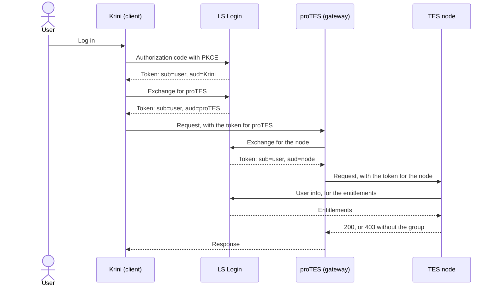

# The flow

## The chain

```text
User -> Krini -> proTES -> TES node
User -> Krini -> Conquest -> proTES -> TES node
```

Each caller gets a token for the next service before calling it, by exchanging the token it holds ([RFC 8693](https://datatracker.ietf.org/doc/html/rfc8693)). The user stays the subject; the audience changes at each hop.



With Conquest in the chain, Krini exchanges for Conquest, and Conquest for proTES.

## Why per hop

This is the design in [proTES #391](https://github.com/elixir-cloud-aai/proTES/issues/391), which is a proposal, not a decision.

- **A stolen token is only good for one service.** One audience per node means that a token stolen at one node can't be used at another.
- **No stored credentials at the gateway.** A gateway with a background poll has no user request behind it, so no token to exchange once the user's has expired. A thin gateway only acts within a request.
- **Each service can remain ordinary.** Downstream services, including TES implementations we don't control, only need standard validation of JWT access tokens ([RFC 9068](https://datatracker.ietf.org/doc/html/rfc9068)).
- **Each node decides for itself.** Authorisation at the gateway only covers who may use the gateway; the node applies its own policy.

Long-running work is the hard case: workflows run for days, so Conquest would need a refresh token for each run, limited to proTES. Whether LS Login can issue that is an [open question](../open-questions.md).

## What the services do here

- **Validation:** as in FOCA's `foca.security.auth._validate()` with its defaults (checked against FOCA 0.19.0): trusted issuer, `typ` is `at+jwt`, discovery, signature (RS256), `exp`, `iat`, `iss`, `sub`, `aud`, no leeway. Unlike FOCA, it tells the caller the reason.
- **Node:** validates, reads entitlements from user info, applies its own policy (403 without the group), reports what it saw.
- **Gateway:** validates, exchanges the token for the next hop, forwards, reports all hops. With another role, the same code is the orchestrator.
- **`Hop-Limit` header:** further forwards allowed, by default 8; at 0 a forwarding service answers 508. It's custom, as `Max-Forwards` only applies to TRACE and OPTIONS.
- **`traceparent`:** valid [W3C Trace Context](https://www.w3.org/TR/trace-context/) values pass through unchanged, others are replaced.
