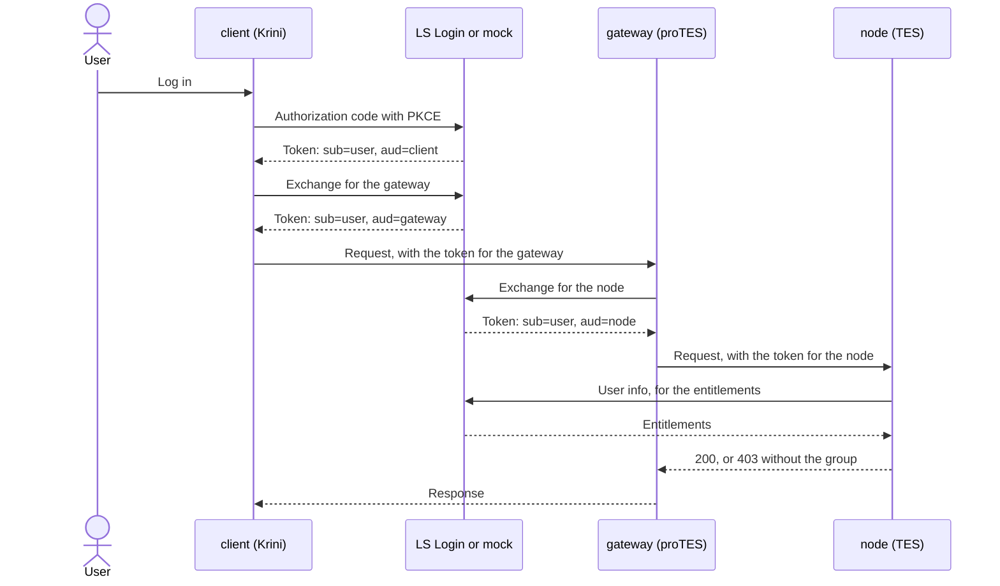

# Testbed design

## The chain

```text
User -> Krini -> proTES -> TES node
User -> Krini -> Conquest -> proTES -> TES node
```

Each caller gets a token for the next service before calling it, by exchanging the token it holds. The user stays the subject; the audience changes at each hop.



With the orchestrator in the chain, the client exchanges for the orchestrator, and the orchestrator for the gateway. This diagram is the plan. Against LS Login, it's what the tests are meant to show, and nothing more so far.

## What the services do

- **Validation:** as in FOCA's `foca.security.auth._validate()` with its defaults (checked against FOCA 0.19.0): trusted issuer, `typ` is `at+jwt`, discovery, signature (RS256), `exp`, `iat`, `iss`, `sub`, `aud`, no leeway. Unlike FOCA, it tells the caller the reason.
- **Node:** validates, reads entitlements from user info, applies its own policy (403 without the group, 502 if user info gives no answer), reports what it saw.
- **Gateway:** validates, exchanges the token for the next hop, forwards, reports all hops. With another role, the same code is the orchestrator. Authorisation at the gateway only covers who may use the gateway.
- **`Hop-Limit` header:** further forwards allowed, by default 8; at 0 a forwarding service answers 508. It's custom, as `Max-Forwards` only applies to TRACE and OPTIONS.
- **`traceparent`:** valid [W3C Trace Context](https://www.w3.org/TR/trace-context/) values pass through unchanged, others are replaced.

## The rules in local runs

The mock accepts almost everything, so `src/testbed/rules.py` makes a local run behave like LS Login as its team described it on 2026-11-03: the exchanging client must be in the subject's `aud`, targets must be registered, and the subject must be valid. **These checks run in the testbed, on the mock only,** with `refused_by: testbed rule (mock only; not LS Login)`, and with error codes of our choosing. `--no-rules` turns them off, to show what the mock itself lets through. Against LS Login, none of them apply.

## How it runs

The testbed runs in containers from one image, built without any secrets, next to the mock's own image. They share a network namespace, so everything talks over `localhost`, in containers as on a host: tokens have the same issuer in both, and a browser's redirect URI stays the same.

- `compose.yaml`, for the mock: `mock` holds the namespace, and nothing is published on the host.
- `compose.lslogin.yaml`, for LS Login: the service `network` holds the namespace, so that `services` can be recreated with new settings while a session keeps its tokens in memory. Only the login callback is published, on the host's loopback interface.

## Secrets and personal data

- Tokens exist only in memory, and in the session only for its length. Output, logs and records hold decoded claims, without signatures and with nested tokens (e.g., visas) removed. A refresh token that's a JWT has its claims decoded in the same way, and an opaque one is shown as "present".
- Each end-to-end run scans all its output for JWTs and secrets.
- Client secrets only come from the environment. The image has none.
- The mock's fixtures are made-up users. Its signing keys are public defaults: it's for local use only.
